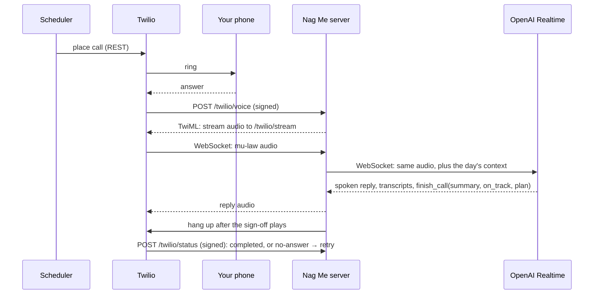

# Nag Me

An AI accountability coach that phones you during your work hours and asks what you're actually doing.

The first call of the day asks for your plan. Later calls check what you're doing against that plan, and the coach remembers what you said earlier. If you don't pick up, it calls back. Every call is logged with a summary, an on-track verdict and a transcript.

- **Real phone calls** through Twilio, at slightly random times inside the work hours you set, in your time zone.
- **Natural conversation** with OpenAI's realtime voice model. You can interrupt it mid-sentence.
- **It remembers today**: your plan, earlier check-ins and how many calls you dodged.
- **Dodging has a cost**: a missed call gets retried a few minutes later, and it shows up on the dashboard.
- **Three coach styles**: supportive, strict and sarcastic.
- **A small dashboard** behind a password, for settings, "call me now" and your call history.

## How it works



Phone audio is 8 kHz G.711 mu-law. The realtime API accepts that format directly, so audio passes straight through without conversion. That keeps latency low. The model handles turn-taking. When you talk over it, the server cuts the coach's audio on the line and tells the model how much of its reply you actually heard.

| File | What it does |
| --- | --- |
| `nagme/schedule.py` | When to call: random gaps inside your work hours, in your time zone, safe across daylight-saving changes |
| `nagme/calls.py` | The call lifecycle: dial, answered, completed or missed, retries, stale-call cleanup |
| `nagme/bridge.py` | The live conversation: relays audio between Twilio and OpenAI, handles interruptions and hang-up |
| `nagme/coach.py` | The coach's personality and the context it gets on each call |
| `nagme/telephony.py` | Twilio: placing calls, TwiML, webhook signature checks |
| `nagme/app.py` | FastAPI routes: dashboard, settings, Twilio webhooks, media stream |
| `nagme/db.py` | SQLite: one settings row and a log of every call |

## Setup

You need Python 3.12+ and [uv](https://docs.astral.sh/uv/).

```bash
git clone https://github.com/Liamoiknine/nag-me
cd nag-me
uv sync
cp .env.example .env
```

Then fill in `.env`:

1. **Twilio.** Sign up for a [free trial](https://www.twilio.com/try-twilio), claim the trial phone number, and add your own cell under *Phone Numbers → Verified Caller IDs*. Copy the Account SID, Auth Token and the Twilio number.
2. **OpenAI.** Create an [API key](https://platform.openai.com/api-keys) with access to the Realtime API. A monthly budget limit on the project is a good idea.
3. **A public URL.** Twilio has to reach your machine. The simplest free option is [ngrok](https://ngrok.com), which gives every free account one static domain: run `ngrok http --url=<your-static-domain> 8000` and put `https://<your-static-domain>` in `PUBLIC_URL`.
4. **A dashboard password** in `ADMIN_PASSWORD`.

Run it:

```bash
uv run python -m nagme
```

Open http://localhost:8000. Sign in, enter your phone number and work hours, and turn calls on. **Call me now** places a test call right away.

### On a Twilio trial account

A trial account is enough, with two limits:

- It can only call verified numbers, which is fine for calling yourself.
- Each call opens with Twilio's trial message, and you have to press a key before the coach starts. If you don't press a key, the call counts as dodged and gets retried.

### Cost

On a trial account, Twilio's charges come out of the free trial credit. That credit covers about $1 a month for the number and about 1¢ per minute of calling. OpenAI bills per minute of audio, and with `gpt-realtime-mini` a typical one-minute check-in costs a few cents.

## Development

```bash
uv run pytest            # tests, including a full simulated call against a fake OpenAI
uv run ruff check .      # lint
uv run ruff format .     # format
```

The tests need no keys or network. They fake Twilio and OpenAI and run a whole call: the scheduler dials, the signed webhooks arrive, audio streams both ways, the caller interrupts, the coach ends the call, and the outcome is saved.

## Security

- The dashboard needs a password, and the server listens on `127.0.0.1` by default. Only the tunnel exposes it.
- Twilio webhooks are rejected unless their `X-Twilio-Signature` matches.
- Each media stream must present a one-time token, issued when that call was dialed.
