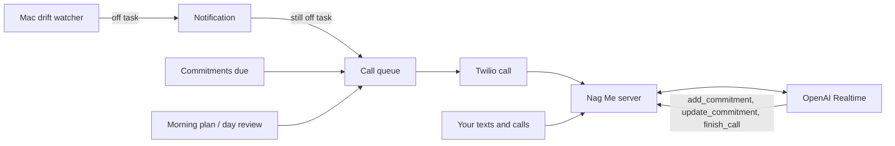

# Nag Me

An AI accountability coach that phones you, but only when there's a reason.

Most "accountability" apps ping you on a timer, which interrupts you even when you're working. Nag Me stays quiet while you're on track. It calls when:

- **Work starts:** a morning call gets your plan and a finish time for each thing that matters today.
- **Something you committed to is due:** "You said the memo would be done by 2. Is it?"
- **You've drifted:** a watcher on your Mac notices you've spent most of the last 15 minutes on YouTube. You get a notification first, and a call if you don't get back to work.
- **Work ends:** a two-minute review of what you planned versus what you got done, plus the first task for tomorrow.

You can also start a focus session yourself: call or text the Nag Me number ("starting the deck, 45 min"), use the menu bar icon, or add it on the dashboard. You'll get a call when the time's up.

Every call is a real phone conversation with OpenAI's realtime voice model. You can interrupt it, and it remembers your day. The dashboard and scorecard show commitments done versus missed, minutes drifted and calls dodged, for today and the past week.

## How it works



On a call, the coach knows your plan, today's commitments and their status, earlier calls, dodged calls and drift time. It has three tools:

- `add_commitment` books the next check-in call.
- `update_commitment` marks a commitment done, moves it to a new time, or drops it.
- `finish_call` saves a summary and hangs up once its sign-off has played.

Phone audio (8 kHz G.711 mu-law) passes straight through to the realtime API without conversion. The model uses semantic turn detection, so it waits for you to finish a thought.

| File | What it does |
| --- | --- |
| `nagme/calls.py` | Why and when to call: morning, deadline, drift, review; retries, snooze, commitments |
| `nagme/activity.py` | The Mac drift watcher: front app, browser tab domain, idle time; notification, then call |
| `nagme/bridge.py` | The live conversation: relays audio between Twilio and OpenAI, runs the coach's tools |
| `nagme/coach.py` | The coach's instructions for each kind of call, and its tool definitions |
| `nagme/texts.py` | Text commands ("memo by 3pm", "done with memo", "busy 30") parsed by a small model |
| `nagme/scorecard.py` | Daily and weekly numbers |
| `nagme/tunnel.py` | A free Cloudflare quick tunnel, so Twilio can reach your laptop |
| `nagme/menubar.py` | The macOS menu bar icon |
| `nagme/app.py` | FastAPI routes: dashboard, scorecard, Twilio webhooks, media stream |

## Setup

You need a Mac (for drift detection and the menu bar; everything else runs anywhere), Python 3.12+, [uv](https://docs.astral.sh/uv/) and `brew install cloudflared`.

```bash
git clone https://github.com/Liamoiknine/nag-me
cd nag-me
uv sync
cp .env.example .env
```

Fill in `.env`:

1. **Twilio.** Sign up for a [free trial](https://www.twilio.com/try-twilio), get a phone number with the trial credit, and add your cell under *Phone Numbers → Verified Caller IDs*. Copy the Account SID, Auth Token and the Twilio number.
2. **OpenAI.** Create an [API key](https://platform.openai.com/api-keys) with Realtime access. Setting a monthly budget limit on the project is a good idea.
3. **A dashboard password** in `ADMIN_PASSWORD`.

Leave `PUBLIC_URL` blank. On startup Nag Me opens a free tunnel and points your Twilio number's calls and texts at it.

```bash
uv run python -m nagme --menubar
```

Open http://localhost:8000, sign in, set your phone number and work hours, and turn calls on.

The first time the drift watcher reads your browser's tab, macOS asks to allow controlling the browser. Allow it, or drift detection only sees app names.

To start Nag Me automatically at login, with the menu bar icon:

```bash
uv run python -m nagme install-login     # uninstall-login to undo
```

### On a Twilio trial account

A trial account is enough, with these limits:

- It only calls and accepts texts from your verified number.
- Every call opens with Twilio's trial message. Press any key and the coach starts. A call that's answered without a key press (by voicemail or iPhone call screening) counts as dodged. Save the Nag Me number as a contact so it rings through.
- Texts you get back start with "Sent from your Twilio trial account."

### Cost

On a trial, Twilio's charges come out of the free credit: about $1.15 a month for the number, about 1.4¢ per minute of calling, and under a cent per text. OpenAI bills per minute of voice audio, and with `gpt-realtime-mini` a one-minute call costs a few cents. Parsing a text costs a fraction of a cent.

## Privacy

The drift watcher records only the front app's name, the domain of the browser's active tab (no full URLs or page titles) and whether you're idle. It only records during work hours, keeps everything in the local SQLite file, and deletes samples after 30 days. Drift detection can be turned off in Settings.

## Development

```bash
uv run pytest            # tests, including a full simulated call with tools
uv run ruff check .      # lint
uv run ruff format .     # format
```

The tests need no keys and no network. They fake Twilio, OpenAI, the Mac sampler and the text parser.

## Security

- The dashboard needs a password, and the server listens on `127.0.0.1`. Only the tunnel exposes it.
- Twilio webhooks are rejected unless their `X-Twilio-Signature` matches.
- Each media stream must present a one-time token issued for that call.
- Incoming calls and texts are only acted on when they come from your number.
